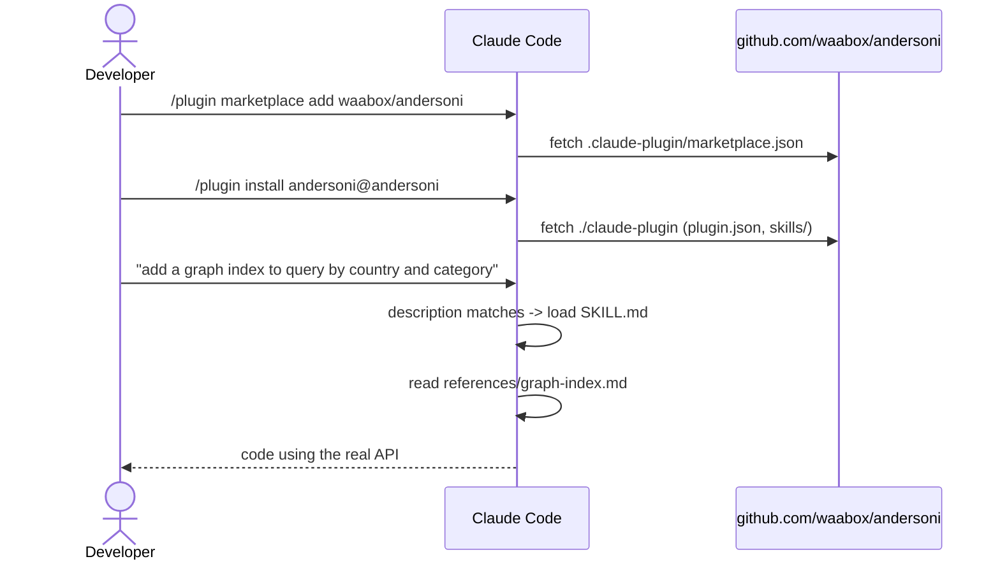
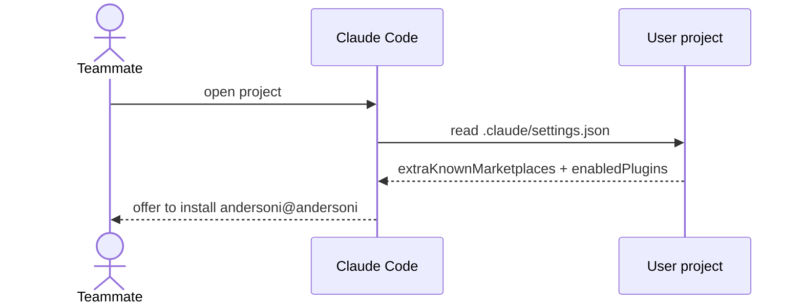
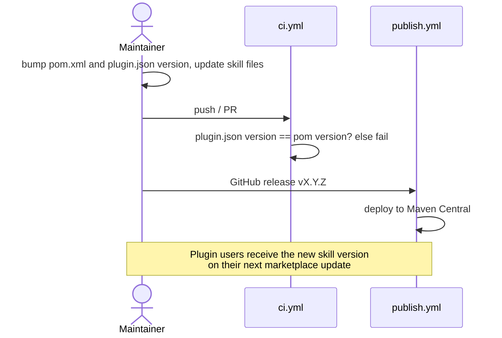

# Claude Code Skill Distribution

## Context

Andersoni's API is not guessable: `indexGraph` (not `graphIndex`),
`graphQuery().where(f).eq(v)`, catalogs registered through `CatalogRegistrar`,
only three `andersoni.*` Spring properties, most modules wired as plain beans.
A baseline test showed that an AI agent without project context invents the
graph DSL, the query API and every configuration key.

To make integration simple, the repository ships a Claude Code plugin that
contains one skill, `andersoni`, documenting the whole public surface. The
repository itself is the plugin marketplace, so the skill is versioned and
released together with the library.

## Business rules

1. The repository root holds `.claude-plugin/marketplace.json` (marketplace
   `andersoni`) with a single plugin `andersoni` sourced from `./claude-plugin`.
2. `claude-plugin/.claude-plugin/plugin.json` `version` MUST equal the Maven
   project version. CI (`ci.yml`) fails the build when they differ, so every
   version bump updates both files.
3. The skill lives in `claude-plugin/skills/andersoni/`:
   - `SKILL.md` is the entry point: fit check, module picker, integration
     workflow, a minimal compilable example and the traps that bite first.
     It stays short because it is loaded whenever the skill triggers.
   - `references/*.md` hold the detailed, per-area reference and are read on
     demand: `catalog-dsl`, `querying`, `graph-index`,
     `engine-and-operations`, `cluster-modules`, `spring-boot`.
4. Every class, method, property, default and exception in the skill must
   match the code of the documented version. Documented behavior follows the
   code, including known defects (e.g. FAILED catalogs not cleared by a
   manual refresh), until the code changes.
5. Any change to the public API, defaults, properties, module wiring or
   observable behavior must update the affected skill files in the same
   change.
6. The skill is written in English.

## Domain events

Not applicable (documentation and distribution only).

## Sequence diagrams

Installation and use:



Project-wide enablement:



Release:



## API contracts

`.claude-plugin/marketplace.json`:

```json
{
  "name": "andersoni",
  "owner": { "name": "waabox", "url": "https://github.com/waabox" },
  "plugins": [ { "name": "andersoni", "source": "./claude-plugin" } ]
}
```

User project `.claude/settings.json`:

```json
{
  "extraKnownMarketplaces": {
    "andersoni": { "source": { "source": "github", "repo": "waabox/andersoni" } }
  },
  "enabledPlugins": { "andersoni@andersoni": true }
}
```

Commands: `/plugin marketplace add waabox/andersoni`,
`/plugin install andersoni@andersoni`. Skill id when invoked explicitly:
`/andersoni:andersoni`. Validation: `claude plugin validate .` and
`claude plugin validate ./claude-plugin`.

Manual fallback: copy `claude-plugin/skills/andersoni/` into the project's
`.claude/skills/andersoni/` (invoked as `/andersoni`, no automatic updates).

## Constraints

- Plugin updates follow `plugin.json` `version`: with a version set, users
  only receive changes when it is bumped. Skill fixes between library
  releases need a version bump or wait for the next release.
- The skill documents one library version. Users on older versions may get
  API that does not exist for them.
- `SKILL.md` frontmatter description is used for triggering; it lists
  triggers only, never the workflow.
- Plugins are not loaded in Claude Code cloud sessions.

## Tradeoffs and rejected alternatives

| Alternative | Why rejected |
|---|---|
| Skill packaged inside the Maven jar (`META-INF/`) | Claude Code does not discover skills in jars; it would need a Maven plugin to extract it |
| Separate marketplace repository | Skill and library drift apart; two release processes |
| Only a manual copy into `.claude/skills/` | Every project keeps a stale copy; no updates |
| Omitting `version` (updates on every commit) | `main` can be ahead of the released library, so users would get docs for unreleased API |
| One large `SKILL.md` | Loaded on every trigger; references keep the context small |

Verification approach: a baseline agent without the skill produced invented
API; agents restricted to the skill files produced a Spring Boot integration
(graph index, Kafka, K8s lease, S3) and a plain Java integration (search,
multi-key, ranges, compound with views) that compile and run against 1.12.0,
and answered operational questions correctly.

## Open questions

- Should the skill note per-version differences (e.g. `graphQuery` typed
  since 1.5.1, build hooks since 1.9.0) for users on older releases?
- Library defects surfaced while writing the references are documented as
  current behavior; each needs a decision (fix or keep): graph `CompositeKey`
  collisions between hotpaths of one index, FAILED catalogs not cleared by a
  successful leader refresh, silent empty result when no hotpath leads with a
  queried field, `search` vs `query` inconsistency on unknown indexes,
  `startsWith` `ClassCastException` on non-String sorted keys, unused
  `syncReceiveFailed`, `stop()` not closing the `SnapshotStore`, no Kafka
  producer timeout configuration, stale starter README.
